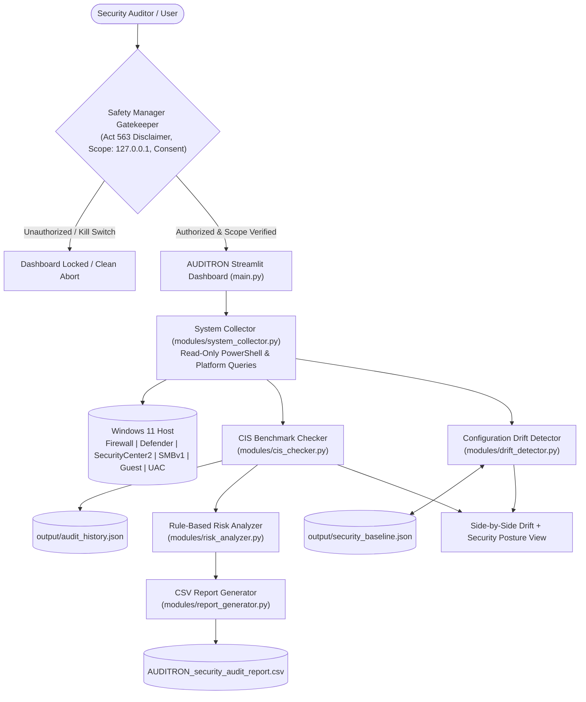

# 🛡️ AUDITRON

**Assess. Analyze. Assure.**

Windows Security Auditing & Configuration Drift Detection Platform

AUDITRON is an educational cybersecurity auditing platform developed using Python and Streamlit. It inspects selected Windows security configurations, identifies potential security weaknesses, performs preliminary risk analysis, and detects configuration changes.

The platform provides a centralized dashboard for security auditing and configuration monitoring. It follows a read-only approach and does not automatically modify system security settings.

---

## Project Information

- **Project Name:** AUDITRON
- **Project Category:** Auditing
- **Platform:** Windows 11
- **Programming Language:** Python
- **Framework:** Streamlit
- **Version:** 1.1.0
- **Project Type:** Educational Cybersecurity Project

## Table of Contents

1. [Project Objectives](#1-project-objectives)
2. [Main Features](#2-main-features)
3. [Attack Lifecycle Mapping](#3-attack-lifecycle-mapping)
4. [System Architecture & Workflow Diagram](#4-system-architecture--workflow-diagram)
5. [Technologies Used](#5-technologies-used)
6. [Project Structure](#6-project-structure)
7. [Installation](#7-installation)
8. [How to Use](#8-how-to-use)
9. [Testing](#9-testing)
10. [Security and Ethical Considerations](#10-security-and-ethical-considerations)
11. [Rules of Engagement (RoE)](#11-rules-of-engagement-roe)
12. [Legal Disclaimer](#12-legal-disclaimer)
13. [Data Handling](#13-data-handling)
14. [Responsible Disclosure](#14-responsible-disclosure)
15. [Scope and Limitations](#15-scope-and-limitations)
16. [Future Improvements](#16-future-improvements)

---

## 1. Project Objectives

The main objectives of AUDITRON are to:

- Inspect selected Windows security configurations.
- Identify potential security weaknesses and configuration issues.
- Establish a reference security configuration baseline.
- Detect configuration changes through baseline comparison.
- Classify security findings using rule-based risk levels.
- Generate downloadable security audit reports.
- Promote ethical, authorized, and responsible security auditing.

## 2. Main Features

### 2.1 CIS Benchmark Checker

Inspects selected Windows security controls:

- Windows Firewall
- Microsoft Defender
- Third-Party Antivirus Provider Detection
- SMBv1 Protocol
- Built-in Guest Account Status
- User Account Control (UAC)

The checker displays five possible audit statuses:

| Status | Description |
|---|---|
| **PASS** | The checked security requirement is satisfied. |
| **FAIL** | A security configuration does not meet the requirement. |
| **WARNING** | Manual verification or further investigation is required. |
| **INFO** | Informational finding that does not independently indicate failure. |
| **ERROR** | The security check could not be completed reliably. |

> **Important:** AUDITRON checks selected Windows security controls. It is not a complete CIS Benchmark assessment and does not provide official CIS certification.

### 2.2 Configuration Drift Detector

Monitors changes in selected Windows security configurations.

**Main capabilities:**

- Create and save a security configuration baseline.
- Collect current system configuration data.
- Compare current settings against the saved baseline.
- Identify new, missing, or modified controls.
- Display configuration differences.
- Present configuration status separately from the current security assessment.

**Configuration comparison statuses:**

| Status | Description |
|---|---|
| **NO CHANGE** | The current configuration matches the saved baseline. |
| **DRIFT DETECTED** | A configuration value has changed from the baseline. |
| **NEW CONTROL** | A control exists in the current configuration but not in the baseline. |
| **MISSING CONTROL** | A control exists in the baseline but is missing from the current configuration. |

> **Note:** A configuration that matches the baseline is not automatically considered secure. The security assessment must also be reviewed.

### 2.3 Risk Analyzer

Provides preliminary, rule-based risk classification based on audit findings.

**Risk classifications:**

| Risk Level | Description |
|---|---|
| **HIGH** | A significant security issue requires attention. |
| **MEDIUM** | A potential security concern requires review. |
| **LOW** | The checked control meets the configured requirement. |
| **INFORMATIONAL** | The finding provides useful security information. |
| **UNDETERMINED** | The result requires further investigation. |

Each finding may include:

- Finding ID
- Security control
- Audit status
- Risk level
- Risk score
- Priority
- Risk explanation
- Recommended action
- Finding details

> **Important:** AUDITRON uses its own rule-based scoring methodology. Its risk scores are not official CVSS scores and should not be interpreted as formal business-impact ratings.

### 2.4 Report Generator

Generates downloadable CSV security audit reports.

The report contains the following information:

| No. | Report Field |
|---:|---|
| 1 | Generated At |
| 2 | Finding ID |
| 3 | Control |
| 4 | Audit Status |
| 5 | Risk Level |
| 6 | Risk Score |
| 7 | Priority |
| 8 | Risk Explanation |
| 9 | Recommendation |
| 10 | Details |

Reports allow users to review, organize, and document security audit findings.

### 2.5 Safety Manager

Provides core ethical and operational safeguards:

- Startup legal disclaimer referencing Malaysia's Computer Crimes Act 1997 (Act 563).
- Target scope verification with safe default (`127.0.0.1` / `localhost` / local host only).
- Explicit user authorization confirmation before security operations (locking the dashboard until confirmed).
- Validation of permitted read-only operations.
- No automatic security remediation.
- In-app **Emergency Stop (Kill Switch)** to immediately abort active PowerShell collection queries and halt/freeze execution (`st.stop()`) while preserving already-collected in-memory results.

These safeguards are intended to reduce accidental or unauthorized use. They do not replace formal organizational authorization procedures.

## 3. Attack Lifecycle Mapping

Although AUDITRON is a defensive/compliance auditing tool (Category 5: **Auditing**), its workflow maps directly across the stages of the **Ethical Hacking & Security Assessment Lifecycle** to identify and mitigate exposures before an adversary can exploit them:

| Ethical Hacking Lifecycle Stage | Adversarial Equivalent | AUDITRON Module & Implementation | Security Objective |
|---|---|---|---|
| **1. Pre-Engagement & Scoping** | Target Selection | `modules/safety_manager.py` (`validate_target_scope`, `check_authorization`, `get_legal_disclaimer`) | Enforce legal compliance (Act 563), explicit user consent, and safe local target scope (`127.0.0.1` / `localhost`). |
| **2. Reconnaissance & Host Discovery** | System Fingerprinting | `modules/system_collector.py` (`collect_system_info`) | Identify target OS platform, build version, and hostname to contextualize the security audit. |
| **3. Enumeration & Configuration Collection** | Service & Defense Enumeration | `modules/system_collector.py` (`run_powershell`, `Get-NetFirewallProfile`, `Get-MpComputerStatus`, `Get-SmbServerConfiguration`, `SecurityCenter2`, `Get-LocalUser`, UAC `EnableLUA` registry value) | Non-intrusively enumerate active firewall profiles, endpoint protection status, registered AV providers, legacy protocols, the Guest account, and UAC. |
| **4. Vulnerability & Compliance Analysis** | Weakness Identification & Configuration Assessment | `modules/cis_checker.py` (`run_cis_audit`) & `modules/drift_detector.py` (`detect_configuration_drift`) | Evaluate controls against CIS-aligned rules and compare live states against `output/security_baseline.json` to detect unauthorized configuration drift (e.g., disabled firewall or enabled SMBv1). |
| **5. Risk Prioritization & Impact Analysis** | Post-Enumeration Triage | `modules/risk_analyzer.py` (`analyze_risks`, `get_risk_summary`) | Assign Finding IDs (`AUD-001`...), rule-based severity levels (`HIGH`, `MEDIUM`, `LOW`, `INFORMATIONAL`, `UNDETERMINED`), scores (`0–10`), and actionable remediation guidance. |
| **6. Reporting & Remediation Guidance** | Engagement Debrief & Hardening | `modules/report_generator.py` (`generate_csv_report`) & `main.py` (`Report Center`) | Produce structured CSV audit reports and historical tracking (`output/audit_history.json`) to support system hardening and responsible disclosure. |

## 4. System Architecture & Workflow Diagram



## 5. Technologies Used

| Technology | Purpose |
|---|---|
| Python | Main application development |
| Streamlit | Interactive security dashboard |
| PowerShell | Windows security configuration collection |
| Windows Security PowerShell modules | Retrieve selected security information |
| JSON | Store configuration baselines and audit history |
| CSV | Export security audit reports |
| Python unittest | Automated unit testing |
| Pandas | Dashboard data presentation |

## 6. Project Structure

```text
AUDITRON/
│
├── main.py
├── requirements.txt
├── README.md
├── LICENSE
├── .gitignore
│
├── modules/
│   ├── __init__.py
│   ├── system_collector.py
│   ├── cis_checker.py
│   ├── drift_detector.py
│   ├── risk_analyzer.py
│   ├── report_generator.py
│   └── safety_manager.py
│
├── tests/
│   ├── test_cis_checker.py
│   ├── test_drift_detector.py
│   ├── test_risk_analyzer.py
│   ├── test_report_generator.py
│   └── test_safety_manager.py
│
├── output/
│   └── .gitkeep
│
└── docs/
```

Generated baseline and audit-history files are stored locally in the `output/` directory. These files are excluded from the public repository to prevent accidental disclosure of system information.

## 7. Installation

### 7.1 Requirements

Before installing AUDITRON, ensure that the following are available:

- Windows 11
- Python 3.13 or a compatible Python 3 version
- PowerShell
- Internet connection for initial dependency installation

Some security information depends on the Windows PowerShell security modules and permissions available to the current user.

### 7.2 Clone the Repository

```bash
git clone https://github.com/daniaalisya/AUDITRON.git
```

Navigate to the project directory:

```bash
cd AUDITRON
```

### 7.3 Install Dependencies

```bash
python -m pip install -r requirements.txt
```

### 7.4 Run AUDITRON (Streamlit Web Dashboard)

```bash
python -m streamlit run main.py
```

Open the local address displayed in the terminal.

The default address is:

```text
http://localhost:8501
```

### 7.5 Run AUDITRON via Command-Line Interface (CLI Mode)

AUDITRON also includes an `argparse`-powered CLI interface for terminal execution and automated scripting:

```bash
# View CLI help and usage examples
python main.py --help

# Run CIS Benchmark Audit & Risk Analysis in terminal
python main.py --cli --authorize --target 127.0.0.1 --audit

# Create a security baseline
python main.py --cli --authorize --baseline

# Compare current configuration against baseline
python main.py --cli --authorize --drift

# Run audit and export CSV report
python main.py --cli --authorize --audit --report output/audit_report.csv
```

## 8. How to Use

Follow these steps to perform a security audit:

1. Launch the AUDITRON application.
2. Review the startup **Computer Crimes Act 1997 (Act 563)** legal disclaimer and safety notices.
3. Verify the **Target Scope** in the sidebar (safe default: `127.0.0.1` / `localhost`).
4. Tick **"I am authorized to audit this computer"** in the sidebar to unlock the dashboard.
5. Open **CIS Benchmark Audit** and click **Run Security Audit**.
6. Review the pass-rate gauge, metric cards, and security control findings.
7. Open **Configuration Drift** and click **Create Security Baseline**.
8. Click **Compare Current Configuration** to inspect configuration drift alongside a fresh CIS security assessment.
9. Open **Risk Analysis** to review rule-based risk classifications, scores, priorities, and recommendations.
10. Open **Report Center** to generate and download `AUDITRON_security_audit_report.csv`.
11. If an assessment must be aborted immediately at any point, click **Emergency Stop (Kill Switch)** in the sidebar.

### Important Usage Notes

- Create a baseline before performing configuration comparisons.
- A baseline saved before the Guest Account and UAC checks were added reports them as **NEW CONTROL**. Create a new baseline to include them.
- A saved baseline is retained when current dashboard results are cleared.
- Risk analysis and report generation use the latest CIS audit results.
- Confirm authorization and valid local target scope before performing security operations.
- Protect generated reports because they may contain information about the audited computer.

## 9. Testing

AUDITRON uses Python's built-in `unittest` framework to test its modules.

### 9.1 Run All Unit Tests

```bash
python -m unittest discover -s tests -v
```

### 9.2 Run Individual Module Tests

**CIS Benchmark Checker:**

```bash
python -m unittest discover -s tests -p "test_cis_checker.py" -v
```

**Configuration Drift Detector:**

```bash
python -m unittest discover -s tests -p "test_drift_detector.py" -v
```

**Risk Analyzer:**

```bash
python -m unittest discover -s tests -p "test_risk_analyzer.py" -v
```

**Report Generator:**

```bash
python -m unittest discover -s tests -p "test_report_generator.py" -v
```

**Safety Manager:**

```bash
python -m unittest discover -s tests -p "test_safety_manager.py" -v
```

### 9.3 Testing Coverage

The tests cover areas such as:

- Security control status classification.
- Configuration baseline comparison.
- Risk classification and scoring.
- CSV report generation and input validation.
- Authorization, target scope (`127.0.0.1`/`localhost`), legal disclaimer, and permitted-operation validation.

Test results should be based on the latest actual test execution.

## 10. Security and Ethical Considerations

AUDITRON is developed for educational and authorized cybersecurity auditing.

Users must:

- Audit only computers they own or have explicit permission to inspect.
- Confirm the authorized scope (`127.0.0.1`, `localhost`, or the local computer hostname) before performing an assessment.
- Follow applicable organizational security policies.
- Use the tool only for its intended read-only auditing functions.
- Protect generated reports and local audit information.
- Avoid publishing sensitive system information without permission.

## 11. Rules of Engagement (RoE)

### 11.1 Authorized Scope

AUDITRON enforces a strict local host target scope defaulted to `127.0.0.1` (and permitting `localhost`, `::1`, or the local computer hostname). Remote IP ranges and external domains are blocked by `validate_target_scope()`.

Only systems and configurations covered by explicit written authorization may be assessed.

### 11.2 Permitted Activities

- Read-only collection of selected Windows security configurations.
- Inspection of selected security controls.
- Creation of a local security configuration baseline.
- Comparison of current settings against the saved baseline.
- Rule-based risk analysis.
- Local generation of CSV audit reports.

### 11.3 Prohibited Activities

- Unauthorized access to computers or networks.
- Attempting to target external IP addresses or third-party hosts outside the authorized scope.
- Exploitation of vulnerabilities.
- Modification or disabling of security controls through AUDITRON.
- Unauthorized collection or disclosure of sensitive information.
- Use of audit findings to disrupt system operations.

### 11.4 Time Window

Auditing must only be performed during an approved assessment window agreed upon with the system owner or lab instructor, and must cease immediately once the authorized window expires.

### 11.5 Emergency Stop (Kill Switch)

Stop the assessment immediately if unexpected system behavior, operational disruption, or an authorization issue occurs:

1. **In-App Kill Switch:** Click the **🛑 Emergency Stop (Kill Switch)** button in the AUDITRON sidebar to immediately terminate any active PowerShell inspection subprocess, suspend authorization, and freeze dashboard execution (`st.stop()`) while preserving collected in-memory findings.
2. **Process Termination:** Press `Ctrl + C` in the terminal running Streamlit to shut down the local web server.

Do not continue an assessment if permission has been withdrawn.

## 12. Legal Disclaimer

AUDITRON is an educational cybersecurity project and is not intended to facilitate unauthorized access or unlawful computer activities.

Users are responsible for obtaining appropriate authorization and complying with applicable laws, including **Malaysia's Computer Crimes Act 1997 (Act 563)**, where unauthorized access (Section 3), unauthorized access with intent to commit further offences (Section 4), and unauthorized modification of computer contents (Section 5) carry severe legal penalties.

This project does not constitute legal advice or a guarantee of regulatory compliance.

## 13. Data Handling

- **No Data Exfiltration:** All audit information is processed strictly locally on the host machine; no telemetry or findings are transmitted over the network.
- **Local Designated Storage:** Configuration baselines (`output/security_baseline.json`) and audit history (`output/audit_history.json`) are stored locally in the designated `output/` directory with clear labeling.
- **Repository Exclusion:** The `.gitignore` file explicitly excludes `output/*` so local system baselines and audit histories are never committed to GitHub.
- **Report Protection:** Downloaded CSV reports (`AUDITRON_security_audit_report.csv`) contain host security posture details and must be stored securely and shared only with authorized stakeholders.

## 14. Responsible Disclosure

When security misconfigurations, failed CIS controls, or unexpected configuration drift are discovered using AUDITRON, findings must be handled in accordance with coordinated and responsible disclosure principles:

- **Who to Report To:**
  - Report findings strictly to the **authorized system owner, IT/Security Administrator, or designated organization point of contact** (or the **Course / Lab Lecturer** in an academic assessment environment).
  - If a broader software defect in a third-party component is identified, contact the vendor's Product Security Incident Response Team (PSIRT) or national CERT (e.g., **MyCERT / CyberSecurity Malaysia**).
- **When to Report:**
  - Report critical/high-risk misconfigurations (such as disabled Windows Firewall, disabled Microsoft Defender without an active alternative AV, or enabled SMBv1) **immediately upon verification** so the system owner can remediate the exposure promptly.
  - Maintain strict confidentiality and **never publicly disclose** host vulnerabilities or raw audit reports while the system remains unpatched (observing standard 90-day coordinated disclosure embargoes for vendor defects, or permanent confidentiality for private host configurations).
- **How to Report:**
  - Export the structured report via AUDITRON's **Report Center** (`AUDITRON_security_audit_report.csv`), which includes the `Finding ID`, `Control`, `Audit Status`, `Risk Level`, `Risk Score`, `Priority`, `Risk Explanation`, and actionable `Recommendation`.
  - Transmit the report only over **encrypted and authenticated channels** (e.g., encrypted email, secure enterprise ticketing portal) directly to the authorized recipient—never via public repositories, unencrypted messaging, or public forums.

## 15. Scope and Limitations

Current project limitations include:

- The initial platform focuses on Windows 11.
- Only selected Windows security controls are inspected.
- Third-party antivirus detection identifies registered providers but does not independently verify active protection.
- Microsoft Defender findings must be interpreted in the context of installed antivirus configurations.
- Configuration drift detection depends on the available baseline and collected controls.
- Risk classifications are preliminary rule-based assessments, not official CVSS calculations.
- AUDITRON does not provide automatic remediation.
- The tool is not a replacement for a professional security assessment.

## 16. Future Improvements

Potential future enhancements include:

- Expand the number of inspected Windows security controls.
- Improve third-party antivirus protection-status verification.
- Introduce additional risk assessment factors.
- Support PDF and other report formats.
- Improve historical audit comparison.
- Enhance configuration drift visualization.
- Introduce additional security compliance frameworks.

---

**AUDITRON — Assess. Analyze. Assure.**

*Promoting ethical, responsible, and informed cybersecurity auditing.*
